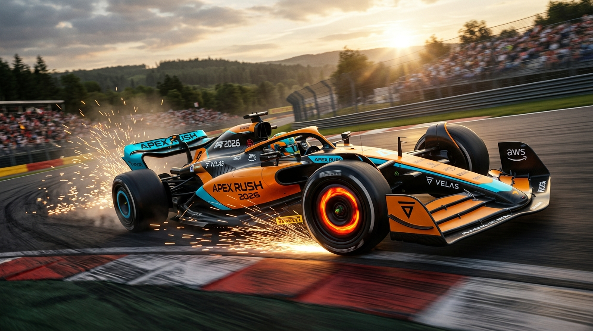

<div align="center">

# 🏎️ Apex Rush: F1 2026

**High-octane arcade F1 racing built in Godot 4 — where photoreal presentation meets exhilarating arcade handling.**

[](https://godotengine.org)
[](LICENSE)
[](CONTRIBUTING.md)
[]()

<br/>



</div>

---

## 🏁 Overview

**Apex Rush** captures the fantasy of threading a modern open-wheel racing machine through tight circuits at over 300 km/h. Built from the ground up in Godot 4, it merges the authentic atmosphere of Formula 1 with fast-paced, accessible arcade mechanics: instant throttle, responsive grip, overtake boost, and precision braking.

Battle for the **World Championship** across a 5-round season, survive **dynamic rainstorms and safety car neutralisations**, battle hyper-aggressive **AI rivals with ERS boost and slipstream drafting**, or chase hundredths against the Gold ghost car in **Time Trial**.

---

## ✨ Features

- 🏆 **Full Championship Season**: 5-round calendar across all circuits with dedicated Saturday qualifying sessions (flying lap sets your grid slot), official FIA points scoring (25-18-15-12-10-8-6-4-2-1), and persistent driver & constructor standings.
- 🌧️ **Dynamic Weather & Rain Physics**: Transitions between Dry, Damp, Light Rain, and Heavy Rain with CPU particle rain emitters, atmospheric fog, and water grip penalties for dry compounds.
- 🚨 **Safety Car Neutralisation**: Deploys when crashes occur, bunches up the pack at a governed pace with flashing amber roof lights, and restarts the race with a flying green flag.
- 🤖 **Hyper-Competitive AI Rivals**: AI drivers deploy tactical ERS overtake boosts (hitting ~98 m/s), take aerodynamic slipstream tows (+12% acceleration), execute inside-line divebombs into braking zones, and defend lines.
- 🗺️ **High-Visibility Directional Minimap**: Real-time 2D track radar with an animated heading chevron, pulsating gold radar halo, and live position tag (`P1..Pn`).
- 🛞 **Tyre Wear & Thermal Simulation**: Soft, Medium, Hard, Intermediate, and Wet compounds with per-wheel degradation, temperature windows, and cliff drops past 80% wear.
- ⛽ **Fuel Mass Dynamics**: Fuel burns off with throttle and boost usage, making the car lighter and more agile over the course of a stint.
- 🛠️ **Active Pit Lane & Crew Stops**: Request a pit stop (`P`), manage the 80 km/h pit lane speed limiter, and receive fresh rubber in animated pit stalls.
- 💨 **Active DRS (Drag Reduction System)**: Real-time detection and activation zones along high-speed straights. Opening the DRS wing flap boosts top end velocity and reduces drag.
- ⚡ **Overtake Boost (ERS)**: Passive energy recharge system with a high-drain boost mode producing an exhaust glow, high-rev intake surge, and tarmac sparks.
- 🚦 **5-Red-Lights Race Starts**: Authentic start sequence with randomized lights-out delays for true reaction tests.
- ⏱️ **Live Delta Telemetry & Standings**: Real-time position tracking (`P1..Pn`), gap to car ahead, micro-delta tracking sampled every 10m, and sector splits.
- ⏪ **Instant Flashback Rewind**: Tap `R` to rewind back to the previous checkpoint after a wall strike or spin; hold `R` to restart cleanly.
- 🛣️ **Authentic Grand Prix Circuits & Dynamic Banking**:
  - **Monte Carlo Street Circuit**: Multi-level elevation climb over the city, the Casino plateau, Portier rock tunnel, descent gallery, and viaduct flyover crossing the start straight.
  - **Spa-Francorchamps**: The Ardennes roller-coaster with the iconic downhill into La Source, 40 m elevation climb through Eau Rouge and Raidillon, and flat-out Kemmel Straight.
  - **Autodromo Nazionale Monza**: The Temple of Speed in the royal park featuring Rettifilo, Curva Grande, Ascari, and the Parabolica.
  - **Silverstone Circuit**: High-speed sweepers with Maggotts-Becketts-Chapel and the Hangar Straight perimeter underpass.
  - **Suzuka Circuit**: The iconic figure-eight layout with the Esses, Degner curves, and 130R underpass.
- 🚇 **Procedural 3D Tunnel System & Flyover Viaducts**: Arched concrete vault roofs, illuminated overhead fluorescent tube lights, structural bridge piers, and realistic concrete soffits.
- 🔊 **Dynamic Audio Acoustics & Slap-Back Echo**: Multi-tap acoustic reverberation when accelerating under tunnel vaults, simulating the thunderous roar of a V6 turbo-hybrid in enclosed spaces.
- ☀️ **HDR Lighting Transitions & Eye Adaptation**: Sunlight dimming inside subterranean sectors with a blinding whiteout bloom burst upon exiting into daylight.
- 🎥 **Multi-Angle Cameras**: Seamless toggling between aggressive close chase, far chase, authentic driver-eye cockpit view behind the halo visor, TV broadcast roll-hoop T-cam, and dynamic trackside cameras.
- 🎨 **PBR Shading & Post-Processing**: Custom cinematic film-grade color grading shaders, lens flare effects, and physically based car materials.

---

## 🎮 Controls

| Action | Keyboard | Controller / Gamepad |
| :--- | :--- | :--- |
| **Accelerate** | `W` or `Up Arrow` | `Right Trigger (RT / R2)` |
| **Brake / Reverse** | `S` or `Down Arrow` | `Left Trigger (LT / L2)` |
| **Steer Left / Right** | `A` / `D` or `Left` / `Right` | `Left Stick` |
| **Overtake Boost** | `Spacebar` | `A / X button` |
| **DRS (in zone)** | `Spacebar` / `E` | `Right Bumper (RB / R1)` |
| **Pit Request (Box Box)** | `P` | `D-Pad Down` |
| **Select Next Tyres** | `1` (Soft), `2` (Med), `3` (Hard), `4` (Wet) | `D-Pad Left / Right` |
| **Flashback (Rewind)** | `R` (Tap) | `Y / Triangle` (Tap) |
| **Restart Race** | `R` (Hold 1s) | `Y / Triangle` (Hold 1s) |
| **Cycle Camera** | `C` | `D-Pad Up` |
| **Pause / Menu** | `Escape` | `Start / Options` |

---

## 🚀 Quickstart & Setup

### Prerequisites
- [Godot Engine 4.x](https://godotengine.org/download) (Forward+ or Mobile renderer compatible)

### Running Locally
1. Clone the repository:
   ```bash
   git clone https://github.com/CodeVerse-AI-TS/F1--2026.git
   ```
2. Open **Godot Engine**.
3. Click **Import**, navigate to the cloned folder, select `project.godot`, and click **Import & Edit**.
4. Press **`F5`** (or the Play button in the top right) to launch the game starting from `scenes/menu.tscn`.

---

## 📂 Project Architecture

```
f-12026/
├── assets/                  # 3D models, textures, sounds, and icons
├── scenes/
│   ├── main.tscn            # Primary 3D race circuit scene
│   └── menu.tscn            # Main menu, team selection, and settings
├── scripts/
│   ├── ai_car.gd            # Competitive AI with ERS boost, slipstream, and divebombs
│   ├── car.gd               # Physics, input handling, DRS, weather wetness, and pit limiter
│   ├── car_model.gd         # Dynamic car geometry, liveries, sparks, wing animations
│   ├── championship.gd      # 5-round championship season logic and points calculation
│   ├── chase_camera.gd      # Smooth dynamic multi-view camera controller
│   ├── engine_audio.gd      # Dynamic RPM pitch and exhaust audio synth
│   ├── game.gd              # Session rules, race starts, safety cars, flashbacks
│   ├── game_state.gd        # Track presets, environmental themes, teams, persistent config
│   ├── ghost.gd             # Ghost car recording and playback
│   ├── hud.gd               # Speedometer, tyre telemetry, standings, weather, and start lights
│   ├── leaderboard.gd       # Persistent lap time and race finish recording
│   ├── safety_car.gd        # Safety car deployment, pace control, and flashing lights
│   ├── track.gd             # Procedural 3D spline tracks, pit lane, and buildings
│   ├── tyre_model.gd        # Soft/Med/Hard/Wet tyre compounds, wear, and thermal grip
│   ├── weather.gd           # Dynamic rain particle simulation and wetness transitions
│   ├── menu/                # Main menu UI and championship registration logic
│   └── ui/                  # Minimap, pause menu, standings screen, and UI components
├── shaders/                 # Custom GLSL / Godot shaders (film grade, lens flare)
└── starter/                 # Materials, urban textures, and visual packs
```

---

## 🤝 Contributing & Roadmap

We are actively seeking contributions for our upcoming milestones! See [`ROADMAP.md`](ROADMAP.md) for the active development checklist.

Please read [`CONTRIBUTING.md`](CONTRIBUTING.md) for our contribution guidelines, GDScript style conventions, and pull request workflow.

---

## 📜 License

Distributed under the **MIT License**. See [`LICENSE`](LICENSE) for details. Third-party asset attributions are detailed in [`LICENSES_SUMMER_ASSETS.md`](LICENSES_SUMMER_ASSETS.md).
